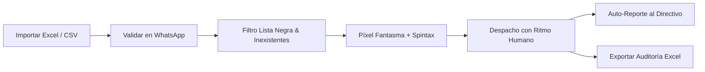

<div align="center">
  
  <h1>FCSender v2.0</h1>
  <p><strong>Agente de Distribución Interna de Comunicaciones Corporativas vía WhatsApp</strong></p>

  <p>
    
    
    
    
    
  </p>
</div>

---

## 📌 Descripción General

**FCSender** es una aplicación de escritorio de alto rendimiento diseñada para que organizaciones y directivos puedan distribuir comunicados oficiales, avisos y material corporativo de manera simultánea a sus colaboradores y contactos autorizados en lotes (*batch*), con un conjunto riguroso de salvaguardas **Anti-Ban**, gestión de **Opt-Out (Lista Negra)** y **Validación Previa de Números**.

A partir de la versión **v2.0**, el software descartó por completo soluciones pesadas e inestables basadas en Puppeteer / Chromium, migrando a una arquitectura nativa con **Evolution Engine (Baileys WebSocket Multi-Device)**, reduciendo el consumo de memoria de ~600MB a ~30MB y eliminando la detección de bots por firmas de navegador.

---

## 🛡️ Pilares y Mecanismos de Protección

### 1. ⚡ Evolution Engine Nativo (0 Puppeteer)
- Conexión binaria directa con los servidores de WhatsApp mediante el protocolo criptográfico **Noise WebSocket** (idéntico a la app móvil oficial).
- **100% Empaquetable**: No requiere Docker, Redis, PostgreSQL ni instalación de navegadores externos en las PCs de los usuarios. Funciona *out-of-the-box* con el instalador `.exe`.
- Vinculación instantánea mediante código QR reactivo y reconexión automática resiliente.

### 2. 🎨 Píxel Fantasma 2.0 (Mutación de Hash Criptográfico)
- Cada imagen enviada es procesada al vuelo con [`sharp`](https://sharp.pixelplumbing.com/):
  - Eliminación total de metadatos de rastreo (EXIF/ICC).
  - Micro-variación imperceptible de brillo, contraste, saturación y compresión de entropía.
  - **Resultado**: Cada destinatario recibe un archivo con un hash criptográfico (**MD5/SHA256**) único, impidiendo que los filtros de spam identifiquen el archivo como un creativo masivo repetido.

### 3. ✍️ Simulación de Comportamiento Humano
- **Presencia realista**: Ciclo `available` $\rightarrow$ lectura/inactividad $\rightarrow$ `composing` ("Escribiendo...") con duración proporcional a la cantidad de caracteres $\rightarrow$ `paused` $\rightarrow$ envío.
- **Delays inteligentes**: Intervalos aleatorios configurables (Min - Max segundos) entre cada mensaje con variación gaussiana.
- **Pausa por lotes**: Descansos programados de seguridad (ej. pausar 5 minutos cada 25 envíos).
- **Spintax dinámico**: Soporte para alternar sinónimos automáticamente mediante sintaxis `{Hola|Buen día|Saludos}`.

### 4. 🚫 Gestión de Opt-Out & Lista Negra Persistente
- **Cláusula de baja voluntaria**: Cada mensaje puede incluir automáticamente el pie de desuscripción:  
  `_Si quieres dejar de recibir promociones, responde "SALIR"_`.
- **Listener en tiempo real**: Detecta respuestas entrantes con palabras clave (`SALIR`, `CANCELAR`, `BAJA`, `STOP`, `NO ENVIAR`).
- **Resolución de LIDs**: Traduce automáticamente los identificadores de privacidad de WhatsApp (`@lid`) a los números telefónicos reales internacionales (`+593...`).
- **Filtro preventivo**: Omite de forma automática e indestructible a cualquier contacto en lista negra en campañas futuras, protegiendo la reputación de la línea.

### 5. 🔍 Validación de Números & Salud de la Base
- Comprobación previa en tiempo real de números registrados en WhatsApp mediante `sock.onWhatsApp(...)`.
- Métricas de **Salud de la Lista** (%) y botón de **Filtrado Rápido de Inexistentes** para evitar flags por envíos a números muertos.

### 6. 📊 Auto-Reporte Ejecutivo & Exportación
- Envío automático de resumen de auditoría directo al chat propio del directivo autenticado con métricas de entregados, fallidos, omitidos y tiempo total.
- Exportación del reporte detallado de envíos a archivo **Excel (`.xlsx`)**.

---

## 🖥️ Capturas y Flujo de Trabajo



---

## 🚀 Instalación y Desarrollo

### Requisitos Previos
- **Node.js** v20.x o superior
- **npm** v10.x o superior
- Sistema Operativo: Windows 10/11 (o macOS/Linux para desarrollo)

### Clonar e Instalar Dependencias
```bash
git clone https://github.com/masteec/fc-sender.git
cd fc-sender
npm install
```

### Ejecutar en Modo Desarrollo
```bash
npm run dev
```

### Compilar y Empaquetar el Instalador de Producción
```bash
# Compilar TypeScript y Vite
npm run build

# Generar el instalador ejecutable para Windows (.exe con NSIS)
npx electron-builder --win -p never
```
El instalador se generará en la carpeta `release/` (ej: `release/FCSender Setup 2.0.0.exe`).

---

## 📂 Estructura del Proyecto

```text
fc-sender/
├── src/
│   ├── main/
│   │   ├── blacklistService.ts   # Persistencia y gestión atómica de Lista Negra (Opt-Out)
│   │   ├── bulkSender.ts         # Motor de despacho, Píxel Fantasma 2.0 y Auto-Reporte
│   │   ├── evolutionService.ts   # Servicio WebSocket Baileys, eventos y resolución LID
│   │   ├── main.ts               # Proceso principal de Electron y ciclo de vida de ventana
│   │   └── preload.ts            # Puente IPC seguro (contextBridge)
│   ├── renderer/
│   │   ├── App.tsx               # Interfaz de usuario React 19 con Tailwind CSS
│   │   ├── index.css             # Estilos globales y temas
│   │   └── main.tsx              # Punto de entrada de React
├── public/                       # Favicons, íconos de aplicación
├── package.json                  # Metadatos, dependencias y configuración de electron-builder
└── vite.config.ts                # Configuración de Vite con plugins de Electron y Tailwind
```

---

## ⚖️ Licencia y Uso Responsable

Este software fue desarrollado para fines de comunicación interna y avisos corporativos autorizados dentro de organizaciones. No está diseñado ni autorizado para prácticas de SPAM o comunicaciones no consentidas.
